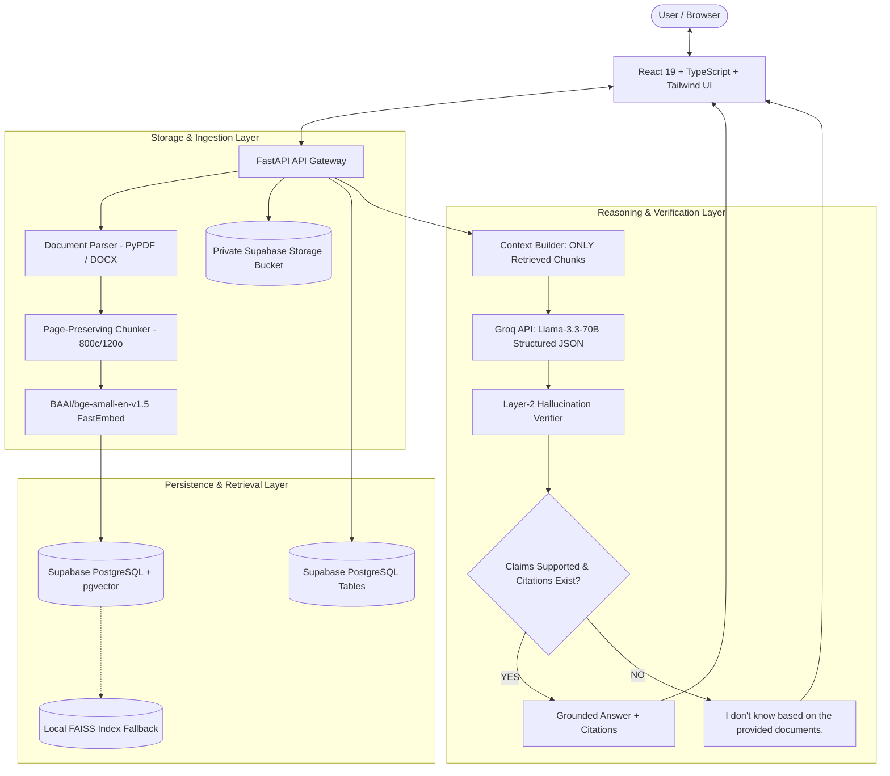
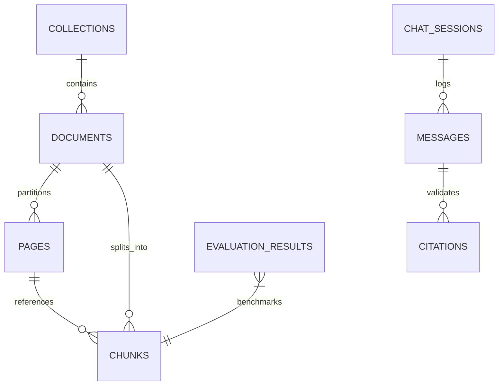
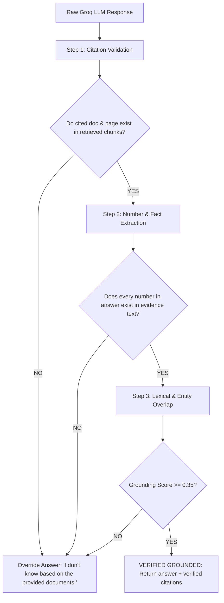

# System Architecture: VERIDOC AI

VERIDOC AI is designed as a **Hallucination-Proof Financial Document Intelligence Platform**. It is architected specifically to eliminate factual hallucination, citation fabrication, and cross-document contamination in SEC 10-K disclosures.

---

## 1. High-Level System Architecture



---

## 2. Persistent Document Data Model

The document structure is persistently modeled across 8 relational and vector tables in Supabase PostgreSQL:



### Hierarchy Breakdown:
1. **`collections`**: Logical isolation boundary (e.g., "Apple Inc. (AAPL) 10-K", "FinanceBench Core"). Queries strictly filter by `collection_id` to prevent cross-company data leakage.
2. **`documents`**: File metadata (file size, SHA256, page count, chunk count, status, storage pointer).
3. **`pages`**: Extracted text partitioned page-by-page to guarantee that financial page references (e.g. Page 24 Consolidated Statements of Operations) remain exact.
4. **`chunks`**: Text sections (~800 characters with 120 character overlap) containing:
   - `page_number`: Exact page source
   - `chunk_index`: Sequential ordinal
   - `content`: Chunk text
   - `embedding`: 384-dimensional vector (`vector(384)`)
   - `metadata`: JSONB metadata
5. **`chat_sessions` & `messages`**: Multi-turn conversation logs with verification status.
6. **`citations`**: Exact document title, page number, chunk ID, and snippet quote linked to every response.
7. **`evaluation_results`**: Benchmark runs tracking Answer Accuracy, Citation Accuracy, Retrieval Accuracy, and Faithfulness.

---

## 3. RAG Retrieval & Prompting Protocol

### A. Vector Indexing with pgvector
Chunks are indexed using an **HNSW (Hierarchical Navigable Small World)** vector index with cosine similarity:
```sql
CREATE INDEX IF NOT EXISTS chunks_embedding_hnsw_idx 
ON chunks USING hnsw (embedding vector_cosine_ops);
```

When a query arrives, it is embedded using `BAAI/bge-small-en-v1.5`, normalized, and passed to the `match_chunks` RPC function:
```sql
SELECT
    c.id, c.document_id, d.title AS document_title,
    c.page_number, c.chunk_index, c.content,
    (1 - (c.embedding <=> query_embedding))::float AS similarity
FROM chunks c
JOIN documents d ON c.document_id = d.id
WHERE (filter_collection_id IS NULL OR c.collection_id = filter_collection_id)
  AND (1 - (c.embedding <=> query_embedding)) >= match_threshold
ORDER BY c.embedding <=> query_embedding ASC
LIMIT match_count;
```

### B. Strict Context Isolation
The full document is **never** sent to the LLM. Only chunks meeting `match_threshold >= 0.70` within `TOP_K <= 5` are sent, formatted strictly as:

```text
DOCUMENT CONTEXT:
[Document: Apple_2023_10K | Page: 24 | Chunk: 2]
Total net sales were $383,285 million in fiscal year 2023...

[Document: Apple_2023_10K | Page: 25 | Chunk: 3]
Total research and development expense was $29,915 million...

USER QUESTION:
What was Apple's total net sales in fiscal year 2023?
```

---

## 4. Layer-2 Hallucination Verification Engine

Even advanced LLMs can hallucinate plausible numbers or fabricate page citations. VERIDOC AI enforces a mandatory post-generation verification step before any answer reaches the user:



### Verification Checks:
1. **Citation Existence Check**: Any citation citing a page number or document name that was not in the retrieved candidate set triggers immediate rejection.
2. **Financial Figure Consistency**: Every distinct financial number (e.g. `$383,285 million`, `2.8%`, `$96,995 million`) in the generated answer is checked against the raw retrieved chunks. If an LLM fabricates a financial number, it is instantly caught.
3. **Lexical Grounding Overlap**: Assesses the token and entity overlap between the answer and retrieved text. If overlap falls below the threshold, the system abstains.
4. **Abstention Protocol**: When any verification check fails, the answer is replaced with:
   $$\text{"I don't know based on the provided documents."}$$
   `supported` is set to `False`, and citations are cleared.

---

## 5. "How Did We Answer This?" Audit Telemetry

Every response generated by VERIDOC AI is paired with an immutable execution trace:
- Total execution latency in milliseconds.
- Retrieved chunks list with rank, cosine similarity score (e.g., 88.4%), document name, page number, and chunk text.
- Factual overlap score (e.g., 92.1%).
- Citation validation status (100% verified or failed).
- Grounding verdict (`VERIFIED_GROUNDED` or `ABSTAINED_UNSUPPORTED`).

This trace is presented interactively to users through the **"How did we answer this?"** modal.
